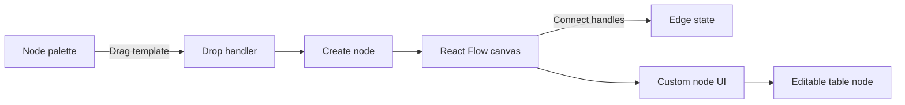
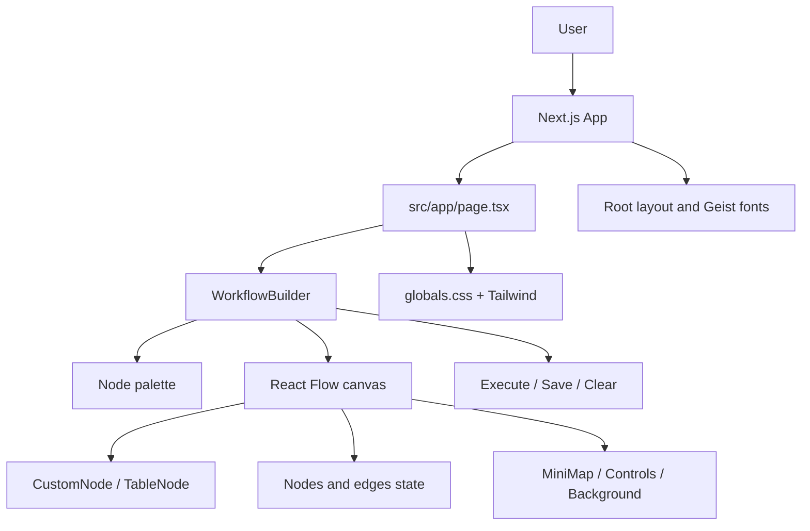

<div align="center">

# FlowForge

### Design workflows visually. Connect logic. Shape your backend.

A node-based workflow editor for building and exploring backend-style flows through a visual canvas.

<br/>


<br/>

**Drag · Drop · Connect · Configure**

</div>

---

## Overview

FlowForge is a visual workflow-editor project built around a node-and-edge canvas. Instead of representing a flow only as code, users can place components on a canvas, connect them, and shape a workflow through an interactive interface.

The current implementation focuses on the **visual editor experience**: a draggable node palette, custom node components, editable table nodes, connection handling, and canvas navigation.

> **Project status:** The repository currently contains the frontend workflow editor. Workflow execution is a UI demonstration, and saving currently logs the workflow structure to the browser console. A production backend, persistent storage, and real execution engine are not included yet.

## What you can do

- **Build on a canvas** — drag node types from the sidebar and drop them onto the React Flow workspace.
- **Connect nodes** — create animated, smooth-step connections between compatible node handles.
- **Work with different node types** — add Database, Email, Webhook, Timer, Code, and Data Table nodes.
- **Edit table content inline** — change the table title, column headings, and cell values inside a custom table node.
- **Navigate larger workflows** — use the canvas controls, zoom, background grid, and minimap.
- **Track the canvas** — see the current node and connection counts.
- **Reset the workspace** — clear all nodes and connections to start again.

## Interface at a glance

| Area | Responsibility |
| --- | --- |
| Node palette | Provides the available node templates |
| Workflow canvas | Hosts, positions, and connects nodes |
| Custom nodes | Displays node labels, icons, and connection handles |
| Data Table node | Provides editable tabular content |
| Canvas controls | Supports zooming, panning, and minimap navigation |
| Action panel | Exposes the current Execute, Save, and Clear actions |

## Built with

| Technology | Use in this project |
| --- | --- |
| [Next.js 15](https://nextjs.org/) | App Router and application setup |
| [React 19](https://react.dev/) | Component model and interactive UI |
| [TypeScript](https://www.typescriptlang.org/) | Project language and type configuration |
| [React Flow 11](https://reactflow.dev/) | Node canvas, edges, handles, minimap, and controls |
| [Lucide React](https://lucide.dev/) | Interface icons |
| [Tailwind CSS 4](https://tailwindcss.com/) | Utility-first styling |
| [@hello-pangea/dnd](https://github.com/hello-pangea/dnd) | Installed drag-and-drop utility (not currently used in the main editor implementation) |

## How the editor works

The current editor is a client-side React component. Node templates are defined in the sidebar. Dragging a template transfers its node metadata; dropping it on the canvas creates a node with a generated ID and canvas position. React Flow manages node and edge state, while custom React components render the node UI.



## Architecture

This diagram describes the **implemented frontend structure**, not a deployed backend architecture.



### Main source layout

```text
.
├── public/
│   └──               # Static visual assets
├── src/
│   └── app/
│       ├── favicon.ico
│       ├── globals.css
│       ├── layout.tsx
│       └── page.tsx   # Workflow editor and custom nodes
├── eslint.config.mjs
├── next.config.ts
├── package.json
├── package-lock.json
├── postcss.config.mjs
└── tsconfig.json
```

## Getting started

### Prerequisites

- Node.js (use a current LTS release)
- npm

### 1. Clone the repository

```bash
git clone https://github.com/adi-codeartist001/No_Code_Backend.git
cd No_Code_Backend
```

### 2. Install dependencies

```bash
npm install
```

### 3. Start the development server

```bash
npm run dev
```

Open [http://localhost:3000](http://localhost:3000) to use the editor.

### Other useful commands

```bash
npm run build
npm run start
npm run lint
```

## Try it out

1. Start the development server.
2. Drag a node from the left sidebar onto the canvas.
3. Add more nodes to lay out your flow.
4. Connect the right-side handle of one node to the left-side handle of another.
5. Add a **Data Table** node and edit its title, headers, and values.
6. Use the minimap and canvas controls to navigate.
7. Try **Clear All** to reset the canvas.

### Current action behaviour

| Action | Current behaviour |
| --- | --- |
| Execute | Checks whether nodes exist, then displays a demo alert with node and connection counts |
| Save | Builds a workflow object with nodes, edges, and a timestamp, logs it to the console, and displays a confirmation alert |
| Clear All | Removes all nodes and edges and resets the node counter |


<div align="center">

**FlowForge** · A visual starting point for workflow building.

Made with React, React Flow, and a lot of connected nodes.

</div>
